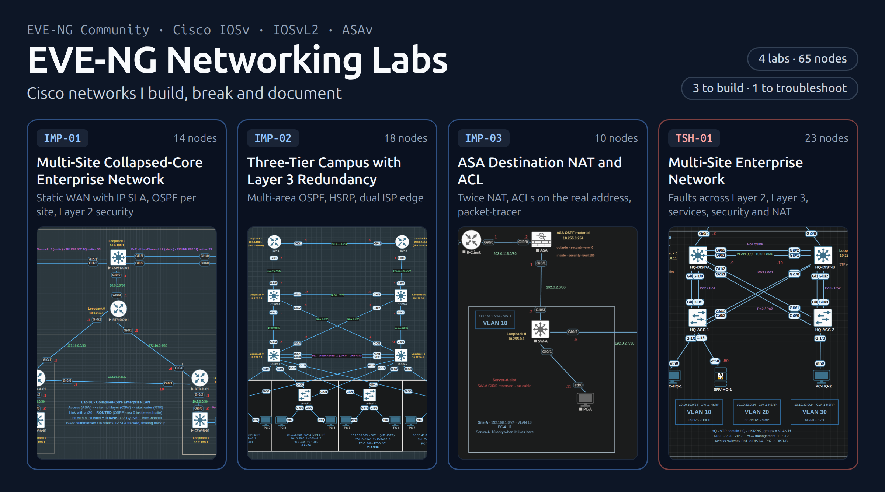

<h1 align="center">EVE-NG Networking Labs</h1>

  Cisco networks I build, break and document in EVE-NG. 
  Each lab ships its topology, addressing plan, sanitised configurations and an acceptance test.

  
  
  
  
  

  

## Lab index

| ID | Lab | Focus | Nodes | Status |
|---|---|---|---:|---|
| [IMP-01](implementation/01-multi-site-collapsed-core/README.md) | Multi-Site Collapsed-Core Enterprise Network | Summarised static WAN with IP SLA, OSPF per site, Layer 2 security | 14 | Complete |
| [IMP-02](implementation/02-three-tier-campus-redundancy/README.md) | Three-Tier Campus with Layer 3 Redundancy | Multi-area OSPF, HSRP, dual ISP edge | 18 | Complete |
| [IMP-03](implementation/03-asa-destination-nat-acl/README.md) | ASA Destination NAT and ACL | Twice NAT, ACLs on the real address, `packet-tracer` | 10 | Complete |
| [TSH-01](troubleshooting/01-multi-site-enterprise/README.md) | Multi-Site Enterprise Network | Multiple faults across Layer 2, Layer 3, services, security and NAT | 23 | Complete |

## Tracks

Every lab belongs to one of three tracks. Each one starts from a different place
and ends with a different deliverable — the same split as a network team's real
work: building a network, fixing one, and finding out what an existing one
actually is.

| Track | ID | You start with | You finish with |
|---|---|---|---|
| **Implementation** | `IMP` | A blank topology, a design and skeleton configurations | A working network that passes its verification, failure tests included |
| **Troubleshooting** | `TSH` | A configured network with injected faults, and an incident ticket | The root causes, and the network restored to its intended state without redesigning it |
| **Discovery** | `DSC` | A running network with no documentation | An as-built: topology, addressing plan, protocol map and a findings report. *No labs published yet* |

Labs are numbered in reading order within their track.

## Requirements

- EVE-NG Community, with enough memory for the lab you pick: each lab states
  its node count.
- Your own Cisco images: IOSv, IOSvL2 and, for IMP-03, ASAv. **No vendor
  software is included in this repository and none can be redistributed.** The
  labs name the image each node uses so you can match it with what you are
  licensed to run.
- No `.unl` files are published. Every lab is rebuilt from its interface map
  and its `configs-skeleton/`, and each README says why.

## Implementation

### IMP-01 — Multi-Site Collapsed-Core Enterprise Network

A three-site enterprise LAN: access switches, a multilayer switch per site doing
both distribution and core, and site routers meshed in a WAN triangle. Inter-site
routing is static, summarised per site, and tied to IP SLA probes so a failed
link is actually withdrawn.

Technologies practised:

- VLAN segmentation and 802.1Q trunking
- Rapid-PVST with deterministic root placement
- EtherChannel between access and multilayer
- OSPF area 0 within each site, authenticated, with pinned router IDs
- Summarised static routing with IP SLA, object tracking and floating backups
- DHCP relay, with the pools on the site routers
- Bidirectional ACL filtering on an isolated VLAN
- Port security, DHCP snooping and Dynamic ARP Inspection
- SSH-only management with a VTY access-class
- NTP hierarchy

[View Lab](implementation/01-multi-site-collapsed-core/README.md)

### IMP-02 — Three-Tier Campus with Layer 3 Redundancy

A campus network built the way a real one is: three hierarchical layers, routed
links between core and distribution, first-hop redundancy for the users, and two
independent Internet upstreams. Nothing in it depends on a single device.

Technologies practised:

- Three-tier hierarchy with routed core-to-distribution links
- Multi-area OSPF with the core as ABRs, point-to-point transits and passive user VLANs
- HSRP with the active gateway alternated per VLAN, and preemption
- Rapid-PVST root placement aligned with the HSRP active gateway
- LACP EtherChannel between the distribution switches
- Dual ISP edge with static routing tracked by IP SLA
- RFC 5737 documentation addressing for everything public-facing

[View Lab](implementation/02-three-tier-campus-redundancy/README.md)

### IMP-03 — ASA Destination NAT and ACL

An external client always reaches a server at one fixed address that belongs to
no subnet in the lab. The server lives in one of two sites, and when it moves,
one line changes on the firewall: the client is never told and the ACL is not
touched.

Technologies practised:

- Twice NAT on a Cisco ASA: destination translation and source PAT in one rule
- An interface ACL written against the real address, built from network objects
- `packet-tracer`, `show nat detail` and ACL hit counters as evidence
- OSPF kept inside the firewall and authenticated; nothing peers with the outside
- A traceroute that survives the firewall, and what that exposes
- RFC 5737 documentation addressing for everything public-facing

[View Lab](implementation/03-asa-destination-nat-acl/README.md)

## Troubleshooting

### TSH-01 — Multi-Site Enterprise Network

A three-site enterprise network — headquarters, branch and disaster recovery —
built to be broken on purpose. It arrives already configured, with faults injected
into the running topology, and the exercise is to work from an incident ticket to
the root causes and back to the intended state without redesigning anything.

Technologies practised:

- 802.1Q trunking, Rapid-PVST and Layer 2 EtherChannel
- VTP and DTP, one VLAN management domain per site
- HSRPv2 gateway redundancy, load-shared and aligned with the spanning-tree root
- Inter-VLAN routing on the distribution layer
- Multi-area OSPF, authenticated, with pinned router IDs
- A tracked static default route, using IP SLA and object tracking
- DHCP with relay, and internal DNS
- PAT toward a simulated Internet
- Extended ACLs for user, guest and management policy
- Port security, PortFast and BPDU guard
- Structured fault isolation from an incident report

The network is built and verified, with the annotated topology, the verification
results measured on the healthy network, and the faulted startup-configs.

[View Lab](troubleshooting/01-multi-site-enterprise/README.md)

## Documentation Format

Every lab folder follows the same layout:

| File | What it is |
|---|---|
| `README.md` | Scenario, topology, design decisions, platform notes and how to run the lab |
| `addressing-plan.md` | Every address, subnet and interface, device by device |
| `verification.md` | The acceptance test: each check with its command and the value it must return |
| `configs/` | Sanitised configurations — the finished state for implementation labs, the faulted state for troubleshooting labs |
| `configs-skeleton/` | The starting point: hostnames, interfaces and addressing, with no protocols |

Troubleshooting labs do not publish their solution or the restored baseline:
next to the faulted configurations, either one would turn the exercise into a
diff.

## Security and Privacy

Passwords, hashes, serial numbers, public credentials, and sensitive values are removed or changed before publishing.

Every address is private (RFC 1918) or documentation-only (RFC 5737), and every lab runs isolated, with no bridge to a real network. The [Checks](.github/workflows/checks.yml) workflow enforces both rules on each push, along with the redaction and the absence of lab exports.
