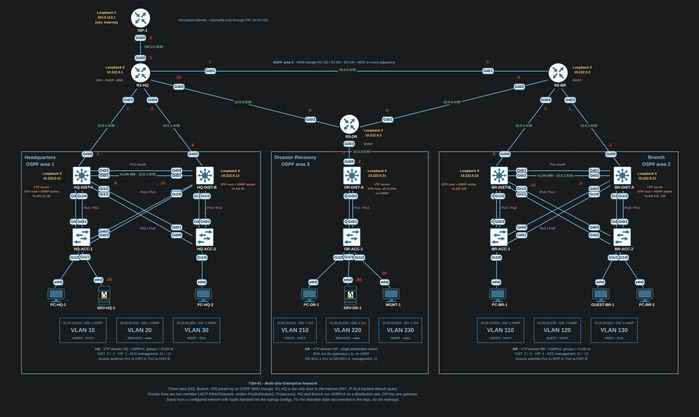

# TSH-01 — Multi-Site Enterprise Network

A three-site enterprise network built to be broken on purpose. The exercise is
not to configure it: the network arrives already configured, with faults injected
into the running topology, and the work is to **read an incident ticket, find the
root causes and restore the intended operational state without redesigning
anything**.

**Difficulty:** advanced · **Environment:** EVE-NG · **Images:** Cisco IOSv,
IOSvL2, VPCS · **Nodes:** 23 (14 qemu + 9 VPCS) · **Links:** 40

---

## Sites

| Site | Role | Distribution | Access | Endpoints | First-hop redundancy |
|---|---|---:|---:|---:|---|
| HQ | Headquarters | 2 | 2 | 3 | HSRPv2 |
| BR | Branch office | 2 | 2 | 3 | HSRPv2 |
| DR | Disaster recovery | 1 | 1 | 3 | none — single distribution switch |

DR is deliberately built without a redundant distribution switch. A recovery site
sized below the primary site is realistic, it keeps the topology inside the RAM
budget of a single EVE-NG virtual machine, and it gives the lab one site where a
gateway failure has no backup — which is a different class of incident from a
site where HSRP simply failed over.

The three sites are joined by a routed WAN triangle, so every site has two
independent paths to every other site.

---

## Topology

Three routers in a triangle, each one the area border router of its own site, and
`R1-HQ` as the only door to the simulated Internet. Every site keeps a second path
to every other site when a WAN link dies. Headquarters and Branch are drawn
mirrored around Disaster Recovery, so the picture reads the same on both sides.

Inside a site, HQ is the pattern. **Branch is identical**, with VLANs 110 / 120 /
130 and its own `10.0.2.x` links. **DR is the same pattern with one distribution
switch and one access switch**, so it has no HSRP and no distribution trunk.

Double lines are two-member LACP EtherChannels, written `Po(distribution) /
Po(access)` on the canvas. Every access switch is dual-homed, one bundle to each
distribution switch, so Layer 2 always has a loop for spanning tree to block — and
the distribution pair keeps an OSPF adjacency through the VLAN 999 transit even if
one of them loses its uplink to the router.

Colour code on the canvas: gold is a loopback, green a link subnet, red the last
octet of an address (next to its interface), purple an EtherChannel, orange a role
and blue a site or a VLAN.

---

## Device inventory

| Node | Image | Interfaces | Role |
|---|---|---:|---|
| R1-HQ | IOSv | 8 | HQ WAN router · PAT to the simulated Internet · DHCP server · DNS server |
| R2-BR | IOSv | 8 | Branch WAN router · DHCP server |
| R3-DR | IOSv | 8 | DR WAN router · DHCP server |
| ISP-1 | IOSv | 4 | Simulated Internet, reachable only through PAT |
| HQ-DIST-A / HQ-DIST-B | IOSvL2 | 8 | HQ distribution, inter-VLAN routing, HSRP peers |
| BR-DIST-A / BR-DIST-B | IOSvL2 | 8 | Branch distribution, HSRP peers |
| DR-DIST-A | IOSvL2 | 8 | DR distribution, single gateway |
| HQ-ACC-1 / HQ-ACC-2 | IOSvL2 | 8 | HQ access, Layer 2 only |
| BR-ACC-1 / BR-ACC-2 | IOSvL2 | 8 | Branch access, Layer 2 only |
| DR-ACC-1 | IOSvL2 | 8 | DR access, Layer 2 only |
| PC-HQ-1, PC-HQ-2, PC-BR-1, PC-BR-2, GUEST-BR-1, PC-DR-1 | VPCS | 1 | DHCP clients |
| SRV-HQ-1, SRV-DR-1, MGMT-1 | VPCS | 1 | Statically addressed server and management hosts |

---

## VLANs

Three VLANs per site, numbered per site so that a VLAN id is never ambiguous
across the WAN. The third VLAN of every site is management, so the management
policy has somewhere to live everywhere — not only where it is convenient.

### Headquarters

| VLAN | Name | Subnet | Gateway | Addressing |
|---:|---|---|---|---|
| 10 | USERS | 10.10.10.0/24 | 10.10.10.1 (HSRP) | DHCP |
| 20 | SERVERS | 10.10.20.0/24 | 10.10.20.1 (HSRP) | static |
| 30 | MGMT | 10.10.30.0/24 | 10.10.30.1 (HSRP) | static, switch SVIs |

### Branch office

| VLAN | Name | Subnet | Gateway | Addressing |
|---:|---|---|---|---|
| 110 | USERS | 10.20.10.0/24 | 10.20.10.1 (HSRP) | DHCP |
| 120 | GUEST | 10.20.20.0/24 | 10.20.20.1 (HSRP) | DHCP |
| 130 | MGMT | 10.20.30.0/24 | 10.20.30.1 (HSRP) | static, switch SVIs |

### Disaster recovery

| VLAN | Name | Subnet | Gateway | Addressing |
|---:|---|---|---|---|
| 210 | USERS | 10.30.10.0/24 | 10.30.10.1 (SVI) | DHCP |
| 220 | SERVERS | 10.30.20.0/24 | 10.30.20.1 (SVI) | static |
| 230 | MGMT | 10.30.30.0/24 | 10.30.30.1 (SVI) | static |

VLAN 999 at HQ and BR carries the routed transit link between the two
distribution switches, so the pair stays adjacent in OSPF even when one of them
loses its uplink to the site router. VLAN 1 is left unused, with no SVI and no
access port assigned to it.

Full addressing, including loopbacks, transit links, DHCP pools and exclusions:
[`addressing-plan.md`](addressing-plan.md).

---

## Technologies, as implemented

Every item below is a decision, not a menu. The lab is built exactly this way,
and "restored" means back to this.

**Layer 2**

- 802.1Q trunking with an explicit allowed-VLAN list on every trunk
- Rapid-PVST, with the root bridge pinned per VLAN to the distribution switch
  that is also the HSRP active gateway for that VLAN
- Two-member Layer 2 EtherChannels: distribution to distribution, and each
  access switch to each distribution switch
- VTPv2, one domain per site, distribution-A as server and every other switch as
  client — VLAN management is centralised inside a site and does not cross the WAN
- DTP left negotiating on the access-to-distribution bundles and switched off
  (`switchport nonegotiate`) on the distribution-to-distribution trunk
- PortFast and BPDU guard on every user-facing port
- Port security on every user-facing port: one MAC address, dynamically learned,
  violation shutdown

**Layer 3**

- Inter-VLAN routing on the distribution switches, one SVI per VLAN
- HSRPv2 at HQ and BR, load-shared: distribution-A is active for USERS and MGMT,
  distribution-B for SERVERS or GUEST, with preemption on both
- Multi-area OSPF: area 0 on the WAN triangle, area 1 for HQ, area 2 for BR,
  area 3 for DR. Router IDs pinned to Loopback0, MD5 authentication on every
  adjacency, user VLANs passive
- A static default route at R1-HQ toward ISP-1, tied to an IP SLA probe and
  object tracking, and injected into OSPF with `default-information originate`

**Services**

- DHCP pools on the site routers, reached by `ip helper-address` on the SVIs, so
  the relay path is part of what can break
- DNS served by R1-HQ (`ip dns server`) for the `corp.local` names, handed to
  clients by DHCP option 6

**Security**

- Named extended ACLs implementing the policy below
- PAT on R1-HQ toward the simulated Internet, with the guest VLAN allowed out and
  denied inward
- SSH-only management, local accounts, RSA 2048, and a VTY access-class that only
  accepts the management VLANs

### Intended policy

| From | To | Result |
|---|---|---|
| USERS (any site) | SERVERS (any site) | permitted |
| USERS | Internet | permitted, via PAT |
| GUEST | Internet | permitted, via PAT |
| GUEST | any internal 10.0.0.0/8 host | denied, except DHCP and DNS |
| MGMT | device management (SSH) | permitted |
| USERS, GUEST | device management (SSH) | denied |

---

## How the exercise works

You are not told which protocol is broken, which device is broken, how many
faults there are, or whether they are related. You get a ticket:

> ### INC-1047 — John cannot reach Server-01
>
> John, in the Headquarters users department, reports that he cannot reach
> Server-01. His workstation does get an IP address. His colleagues in the same
> department say the same, and the one user at the disaster-recovery site cannot
> browse the Internet at all.
>
> The network team worked on the distribution switches yesterday evening. No
> change was documented.
>
> Find the root causes and restore normal operation. Do not redesign the network.

The lab can hold several simultaneous faults, and they are drawn from these
categories:

| Layer | Fault categories |
|---|---|
| Layer 2 | wrong access VLAN, VLAN missing from a switch, trunk carrying the wrong allowed list, native VLAN mismatch, DTP combination that leaves a trunk as an access port, VTP domain or mode wrong, EtherChannel member mismatch, spanning-tree root in the wrong place, port-security violation |
| Layer 3 | wrong address or mask, wrong default gateway, HSRP priority or group inconsistency, OSPF area mismatch, missing network statement, an interface left passive, missing or wrong static route |
| Services | wrong DHCP pool or exclusion, missing `ip helper-address`, wrong DNS address handed out, DNS unreachable |
| Security | ACL that blocks what should pass, ACL that permits guest traffic inward, management traffic blocked |
| NAT | NAT inside/outside on the wrong interface, missing or wrong overload statement, NAT ACL that does not match, no route toward the outside |

A useful discipline, and the order the verification file follows: define the
scope, then work up — physical and Layer 2, VLANs and trunks, spanning tree and
EtherChannel, HSRP, routing, ACLs, DHCP and DNS, NAT — and only then declare a
root cause.

---

## Contents

| Path | What it is |
|---|---|
| [`addressing-plan.md`](addressing-plan.md) | Every address, subnet, pool and virtual IP in the lab |
| [`verification.md`](verification.md) | The acceptance checks, with the exact commands and the value each one must return |
| [`topology.png`](topology.png) | The annotated EVE-NG canvas: every address, bundle, VLAN and role |
| [`configs-skeleton/`](configs-skeleton/) | The base build: hostnames, interfaces, routed links and loopbacks, no protocols |
| [`configs/`](configs/) | The configuration the devices boot with for the exercise, faults included, sanitised |

The restored baseline and the solution to each incident are deliberately **not**
in this repository. Publishing them next to the faulted configurations would
turn the exercise into a diff. They live outside the repo and are opened after
the incident is closed.

---

## Running it

1. **Build the topology in EVE-NG** from [`topology.png`](topology.png): 23 nodes,
   40 links. The wiring is also written in the interface descriptions of
   [`configs-skeleton/`](configs-skeleton/), which name the remote device *and*
   the remote interface. The `.unl` is not published: an exported lab embeds every
   startup-config, and here that would be the faults and, with them, the answer.

   | Node | Image | Interfaces | RAM used here |
   |---|---|---:|---:|
   | R1-HQ, R2-BR, R3-DR | IOSv | 8 (`Gi0/0`–`Gi0/7`) | 512 MB |
   | ISP-1 | IOSv | 4 | 512 MB |
   | the ten `*-DIST-*` and `*-ACC-*` switches | IOSvL2 | 8 (`Gi0/0`–`Gi0/3`, `Gi1/0`–`Gi1/3`) | 768 MB |
   | the nine hosts | VPCS | 1 | — |

   Note the naming: IOSv numbers its interfaces straight through (`Gi0/4` is the
   fifth), IOSvL2 uses two groups of four.
2. **Load [`configs/`](configs/) as the startup-config of each node.** Three
   things are not published and show as `<REDACTED>`: the `enable secret`, the
   `netadmin` secret and the OSPF MD5 key. Put your own values in; the OSPF key
   has to be the same on every device.
3. **Wipe every node before the first start.** EVE-NG only injects a
   startup-config into a node that boots clean; a node that has already run once
   silently uses its own NVRAM instead, and the faults — which live in the
   startup-configs — never arrive. Start the qemu nodes in batches. With the
   memory above, all 23 nodes running used 45 % of a 15 GB EVE-NG VM; stop any
   other lab first.
4. **Three first-boot effects that belong to the platform, not to the exercise:**
   - An SVI that comes from an injected startup-config stays `down/down` on
     IOSvL2 (`show ip interface brief` shows `Method TFTP`). Delete and recreate
     it with its own lines: `show running-config interface VlanN`, then
     `no interface VlanN` and paste the lines back. Do it on the five
     distribution switches before you start looking for faults.
   - SSH needs a key, and keys are not part of a configuration:
     `crypto key generate rsa modulus 2048` on each device you want to reach.
   - The VPCS hosts boot before the network has converged, so their first
     `ip dhcp` finds nothing. Run it again once OSPF is up.
5. Work from the consoles over telnet, or from the management hosts.
6. When you think it is fixed, run [`verification.md`](verification.md) top to
   bottom. A single successful ping is not the finish line: the whole network has
   to be back in its intended state, including the redundancy you did not break.

---

## Status

Built and verified on EVE-NG 6.2.0-4 (IOSv 15.9(3)M4, IOSvL2 15.2). The healthy
network passes every check in [`verification.md`](verification.md), whose
expected values now sit next to the ones measured, and the failure tests in
section 9 were run and restored one by one. [`configs/`](configs/) holds the
startup-configs the devices boot with for the incident.

The restored baseline and the solution are not published, on purpose.

---

## Disclaimer

Educational lab. Every fault in it is deliberate. All addressing is private
(RFC 1918) or documentation-only (RFC 5737): nothing here points at a real
network, and the lab is self-contained, with no bridge to the host or to the
Internet.
